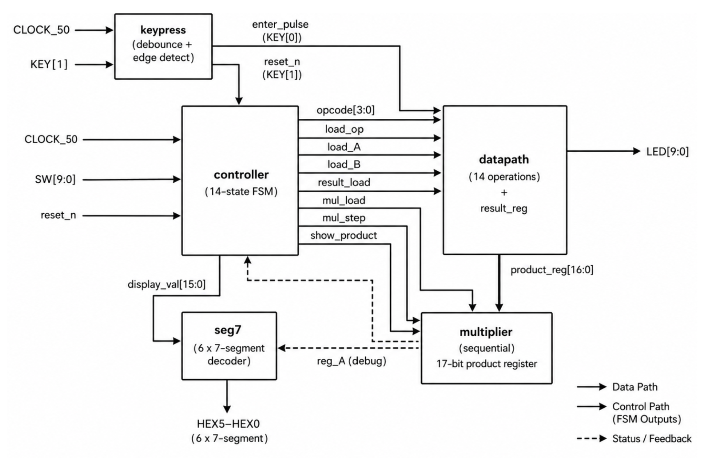
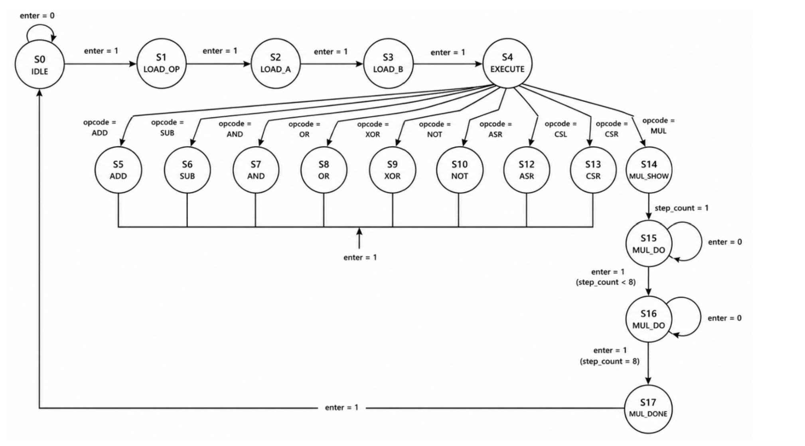
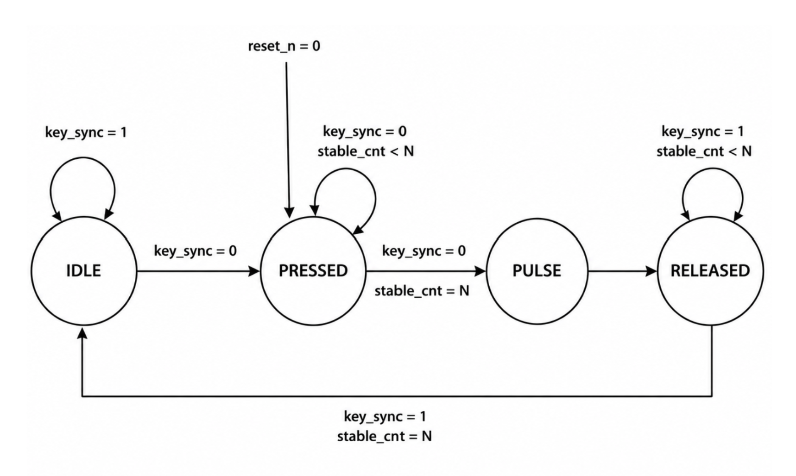
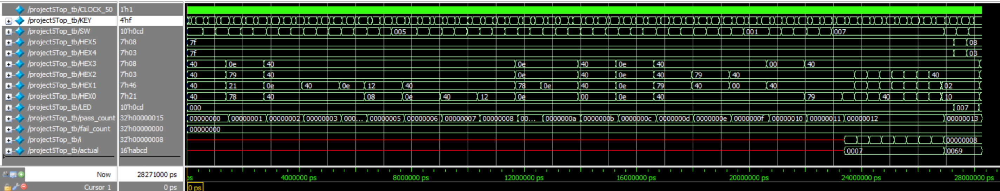

# FSM-Controlled ALU & Sequential Multiplier

**Verilog RTL · FPGA Digital Design · Finite-State Machines · Sequential Arithmetic**

An FPGA-based digital system combining a multi-operation arithmetic and logic datapath, a Moore finite-state machine controller, and an eight-step sequential multiplier.

**14 operations · 14-state controller · 8 multiplication steps · 16-bit result interface**

*Virginia Tech · ECE 3544 · Spring 2026*

---

## Overview

This project implements a finite-state-machine-controlled arithmetic and logic processing system in Verilog HDL for the Intel DE1-SoC FPGA platform.

The design accepts a 4-bit opcode and 8-bit operands through the board's switches, executes the selected operation, and displays hexadecimal results using six seven-segment displays.

The system supports bitwise logic, signed arithmetic, arithmetic shifts, circular rotations, sequential multiplication, and a debug operation for inspecting operand values.

The architecture separates control logic from datapath computation and uses a dedicated multiplier module to perform multiplication over eight clocked steps.

## System Architecture

The following block diagram illustrates the top-level design and the connections between the controller, datapath, multiplier, input debouncing logic, and display decoders.



*Figure 1 — Top-level FSMD architecture, adapted from the project report.*

### Key design features

- **Controller/datapath separation:** A dedicated Moore FSM sequences operand loading, execution, and result presentation.
- **14 supported operations:** Logic, arithmetic, shifts, rotations, multiplication, and debug functionality.
- **Sequential multiplication:** An iterative shift-and-add algorithm computes an 8-bit by 8-bit product over eight steps.
- **Debounced user input:** The keypress module converts mechanical button interactions into clean single-cycle events.
- **FPGA output interface:** Six seven-segment displays and LEDs provide result visualization and debug information.

## Controller FSM

The controller contains 14 states that manage opcode selection, operand entry, operation execution, and the multi-cycle multiplication sequence.



*Figure 2 — Controller FSM showing operation sequencing and multiplication states.*

A typical two-operand operation follows this sequence:

1. Capture the selected opcode.
2. Load operand A.
3. Load operand B.
4. Execute the selected operation.
5. Register and display the result.

Unary operations, including complement and negation, bypass operand B entry.

Multiplication follows a separate path through initialization, intermediate product display, eight multiplier steps, and completion.

An important design decision was introducing a dedicated decode state after opcode capture. This ensures that the controller reads the registered opcode rather than a stale value during synchronous register updates.

## Supported Operations

The datapath implements 14 operations selected through a 4-bit opcode.

| Opcode | Operation | Description |
|:---:|---|---|
| `0x0` | OR with project constant | Combines `{A, B}` with `16'h1143` |
| `0x1` | NAND | Bitwise NAND of operands |
| `0x2` | NOR | Bitwise NOR of operands |
| `0x3` | XOR | Bitwise exclusive OR |
| `0x4` | Complement | Bitwise complement of A |
| `0x5` | Addition | Adds sign-extended operands |
| `0x6` | Subtraction | Subtracts sign-extended operands |
| `0x7` | Negation | Two's-complement negation of A |
| `0x8` | Arithmetic left shift | Shifts sign-extended A left |
| `0x9` | Arithmetic right shift | Right shift with explicit sign extension |
| `0xA` | Circular left shift | Rotates zero-extended A left |
| `0xB` | Circular right shift | Rotates zero-extended A right |
| `0xC` | Sequential multiplication | Eight-step shift-and-add multiplication |
| `0xD` | Debug | Displays operand information |

The non-multiplication operations produce a registered result after execution. Shift operations complete in one execution cycle regardless of the shift amount.

**Implementation note:** Opcode `0x0` contains a coursework-specific constant. This repository documents the original design behavior rather than presenting it as a general-purpose ALU specification.

## Sequential Multiplier

The multiplier uses an iterative shift-and-add algorithm with a 17-bit product register.



*Figure 3 — Keypress FSM used to generate a clean input event after button debouncing.*

### Multiplication process

1. Load operand A into the multiplicand register.
2. Initialize the product register with operand B.
3. Examine the least significant bit of the product register.
4. If the bit is `1`, add the multiplicand to the upper product field.
5. Shift the product register right by one position.
6. Repeat the process for eight steps.
7. Present the final 16-bit product.

The controller separates waiting for user input from performing a multiplication step. This ensures each step receives a controlled, single-cycle enable signal.

### Example

For operands \(A = 15\) and \(B = 7\):

\[
15 \times 7 = 105 = \texttt{0x0069}
\]

The intermediate product is visible during multiplication, and the final result is displayed after eight steps.

## Button Debouncing

Mechanical pushbuttons can produce multiple rapid electrical transitions when pressed or released.

The keypress module combines a debounce counter with a four-state Moore FSM:

- `IDLE`
- `PRESSED`
- `PULSE`
- `RELEASED`


*Figure 4 — Debouncing and edge-detection state machine.*

The hardware debounce interval is configured for 1,000,000 stable clock cycles, equivalent to 20 ms at 50 MHz. The testbench can use a smaller counter value to speed up simulation.

The resulting pulse ensures a single user interaction advances the controller predictably.

## Verification

The project includes a system-level Verilog testbench that drives the top-level design, simulates button interactions, and compares registered results against expected values.

The report documents test coverage for all 14 operations, including signed arithmetic edge cases, rotation by zero, sequential multiplication, and debug outputs.

### Questa simulation waveform



*Figure 5 — Simulation waveform documented in the project report. The reported pass counter reaches `0x00000013`, while the fail counter remains zero.*

### Verification scenarios

| Test case | Expected result |
|---|---|
| Addition: `0xFF + 0x01` | `0x0000` using signed 8-bit operands |
| Subtraction: `0x80 - 0x01` | `0xFF7F` |
| Arithmetic right shift: `0xF0 >> 4` | `0xFFFF` with sign extension |
| Circular shift by zero | Original zero-extended operand |
| Multiplication: `15 × 7` | `0x0069` after eight steps |
| Debug: A = `0xAB`, B = `0xCD` | Combined result `0xABCD` |

The project report also documents physical-board validation on the DE1-SoC platform.

**Reproducibility note:** The waveform and test results above reflect the supplied project report. Run the current repository's testbench to independently confirm the results after any source or filename changes.

## FPGA Interface

| Signal | Function |
|---|---|
| `CLOCK_50` | 50 MHz system clock |
| `KEY[0]` | Active-low Enter button |
| `KEY[1]` | Active-low asynchronous reset |
| `SW[3:0]` | Opcode selection |
| `SW[7:0]` | Operand input |
| `HEX3–HEX0` | Four-digit hexadecimal output |
| `HEX5–HEX4` | Operand A display in debug mode |
| `LED[7:0]` | Operand B display in debug mode |

## Resource Utilization

The project report records the following Quartus implementation results for the Intel Cyclone V device on the DE1-SoC.

| Resource | Reported result |
|---|---:|
| Logic cells (ALMs) | 243 / 32,070 |
| Dedicated logic registers | 114 |
| Global clocks used | 1 |
| Worst-case setup slack | 13.462 ns |
| Worst-case hold slack | 0.172 ns |

These are values documented in the original report, not a new synthesis run of the current public repository.

## Repository Structure

```text
verilog-fsm-alu/
├── README.md
├── rtl/
│   ├── fpga_top.v
│   ├── controller.v
│   ├── datapath.v
│   ├── multiplier.v
│   ├── keypress.v
│   └── seven_segment.v
├── testbench/
│   └── fpga_top_tb.v
└── docs/
    ├── architecture.png
    ├── keypress-fsm.png
    ├── fsm-diagram.png
    └── simulation-waveforms.png
```

*Ensure these paths match the actual filenames in the repository. If your RTL files retain their original names, update this tree accordingly.*

## Engineering Lessons

This project provided practical experience with:

- Separating combinational datapath logic from sequential control.
- Designing Moore FSMs for deterministic control signals.
- Managing synchronous register updates and opcode timing.
- Implementing arithmetic shifts and rotations with explicit bit manipulation.
- Building an iterative multiplier from register-level operations.
- Debouncing physical pushbuttons and integrating FPGA I/O.
- Creating a testbench for system-level verification.

## Future Improvements

- Automate simulation with a reproducible build script.
- Add randomized and boundary-case tests.
- Capture additional waveforms showing each multiplication step.
- Document synthesis settings and timing constraints.
- Add a short physical-board demonstration.

## Author

**Raghavendra Sharma**  
Computer Engineering · Virginia Tech

Interests: FPGA Design · Digital Systems · Embedded Systems · Hardware/Software Integration

---

*Verilog RTL design combining finite-state control, combinational arithmetic, sequential multiplication, and system-level verification.*