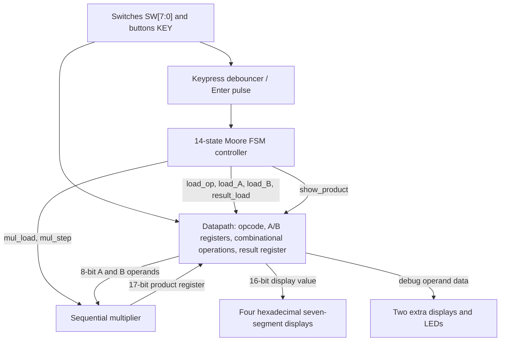
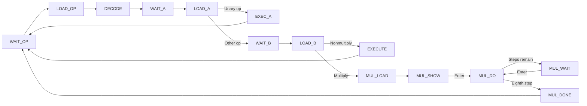

<div align="center">

# FSM-Controlled ALU & Sequential Multiplier

### A Verilog RTL design combining arithmetic/logic processing, finite-state control, and multi-cycle multiplication

  

**14 operations · 14 FSM states · 8-step sequential multiply · 16-bit result interface**

*Digital systems design project • Virginia Tech • Spring 2026*

</div>

---

## Overview

This project implements a **finite-state-machine-controlled arithmetic and logic processing system** in Verilog. An 8-bit operand datapath supports **14 selectable operations**, including bitwise logic, signed arithmetic, shifts, rotations, a step-controlled sequential multiply, and an operand-inspection/debug mode.

A dedicated **Moore-style controller** sequences opcode selection, operand loading, execution, and result presentation. A top-level module connects the controller and datapath to debounced push-button input, a multiplier, six seven-segment displays, and LEDs.

The design was developed for **ECE 3544** at Virginia Tech. This repository documents the architecture and verification approach; it is not presented as a commercial ALU or a benchmarked production processor.

## System Architecture



> Diagram summarizes the module connections in `project5Top.v`; it is not a timing diagram.

### Design highlights

- **Control/datapath separation:** The FSM generates register-load and multiply-step signals independently of the combinational operation logic.
- **Registered operands and result:** Inputs are sampled from switches only when the controller issues load signals.
- **Multi-cycle multiplication:** The controller issues **eight Enter-triggered multiplication steps**, allowing the intermediate product to be displayed.
- **Interactive FPGA I/O:** Push buttons select/advance transactions, switches provide opcodes and operands, and seven-segment displays show the resulting hexadecimal value.
- **Debug mode:** Operand A appears on `HEX5–HEX4` and operand B on `LED[7:0]` when opcode `0xD` is active.

## Operation Set

The operation codes below are taken from the actual `Datapath.v` implementation.

| Opcode | Operation | Notes |
|:---:|---|---|
| `0x0` | OR with project constant | `{A, B} \| 16'h1143` in the original coursework implementation |
| `0x1` | NAND | 8-bit bitwise operation, zero-extended to 16 bits |
| `0x2` | NOR | 8-bit bitwise operation, zero-extended |
| `0x3` | XOR | 8-bit bitwise operation, zero-extended |
| `0x4` | Complement | Bitwise NOT of A |
| `0x5` | Addition | Sign-extended 8-bit operands, 16-bit result |
| `0x6` | Subtraction | Sign-extended operands, 16-bit result |
| `0x7` | Negation | Two's-complement negation of A |
| `0x8` | Arithmetic left shift | Sign-extended A, shift count from B's low nibble |
| `0x9` | Arithmetic right shift | Explicit sign-fill implementation |
| `0xA` | Circular shift left | Rotate 16-bit zero-extended A |
| `0xB` | Circular shift right | Rotate 16-bit zero-extended A |
| `0xC` | Sequential multiplication | Eight manually advanced steps; 16-bit displayed result |
| `0xD` | Debug | `{A, B}` plus displays/LED operand inspection |

**Note:** The first operation contains a coursework-specific constant. If you change it for a public adaptation, update the RTL and testbench together, then revise this table.

## Control FSM

The controller contains **14 encoded states**, handling opcode capture, operand capture, execution, and multiplication. The normal two-operand flow and multiplication flow can be summarized as:



The controller uses the registered opcode, rather than immediately decoding switch inputs during the same cycle as the opcode load. This keeps the state transition consistent with synchronous register updates.

## User Interface

| Signal | Function |
|---|---|
| `CLOCK_50` | 50 MHz clock input |
| `KEY[0]` | Active-low Enter button; press-and-release converted into a pulse |
| `KEY[1]` | Active-low reset |
| `SW[3:0]` | Opcode entry |
| `SW[7:0]` | Operand A or B entry |
| `HEX3–HEX0` | Four-digit hexadecimal result / intermediate product |
| `HEX5–HEX4` | Operand A during debug operation |
| `LED[7:0]` | Operand B during debug operation |

Typical interaction: select an opcode on the switches and press Enter, provide operand A and press Enter, then provide operand B if required. For multiplication, press Enter to advance each of the eight steps.

## RTL and Testbench Layout

The following reflects the recommended **renamed** public-facing layout. Make sure filenames and module references remain consistent with your actual source files.

```text
verilog-fsm-alu/
├── rtl/
│   ├── fpga_top.v          # formerly project5Top.v
│   ├── controller.v        # formerly Controller.v
│   ├── datapath.v          # formerly Datapath.v
│   ├── multiplier.v        # formerly Multiplier.v
│   ├── keypress.v          # formerly keypress.v
│   └── seven_segment.v     # formerly Seg7.v
├── testbench/
│   └── fpga_top_tb.v       # formerly Project5top_tb.v
├── docs/                   # diagrams and waveform screenshots, when added
├── README.md
└── .gitignore
```

**Dependencies:** `Multiplier.v`, `keypress.v`, and `Seg7.v` are referenced by the supplied top-level file, but were not among the four files reviewed for this README. Verify whether they instantiate any additional modules before treating the repository as complete.

## Verification

The provided `Project5top_tb.v` is a **self-checking testbench**. It instantiates the full top-level design, drives a 50 MHz clock, simulates debounced button interactions, and compares internal registered results against expected values.

Test scenarios in the source include:

- All **14 opcodes** (`0x0`–`0xD`)
- Signed addition and subtraction edge cases
- Positive and negative arithmetic right shifts
- Zero-shift cases for both circular rotations
- A sequential multiplication example: `15 × 7 = 105` (`0x0069`)
- Debug result and LED output checks

The testbench records **pass/fail counts**, prints a summary, and finishes the simulation. These are **implemented checks**, not a claim that every check has passed.

### Reproducing the simulation

Once all dependent RTL modules have been included, compile the sources using your preferred Verilog simulator. An example using Icarus Verilog **after renaming only the files** is:

```bash
iverilog -g2012 -s project5Top_tb -o build/sim.vvp \
  rtl/*.v testbench/fpga_top_tb.v
vvp build/sim.vvp
```

Create the build directory first: `mkdir -p build`. If you also rename the Verilog module identifiers, change `-s project5Top_tb` and the testbench instantiation to match. Simulator support for the testbench's `defparam`-based debounce override depends on how `keypress` is implemented.

**Verification status:** A complete compile/simulation run has not been independently confirmed here. Add your real console results and waveforms after running the full project. Do not represent the above example as a passing test log.

## Engineering Decisions

**Moore controller:** Control outputs are determined by the controller state, simplifying the sequencing of register writes and multiplier steps.

**Explicit arithmetic right-shift sign fill:** The datapath constructs a mask for the vacated high bits instead of relying on signed shift operators.

**Separate display multiplexer:** During multiplication, the displayed value can come from the intermediate product register; otherwise, the latched result is shown.

**Debounced button events:** User button actions are translated into single-cycle pulses so one press can advance the state machine in a controlled way.

## Future Improvements

- Add automated compile/simulation scripts and CI checks.
- Capture waveform screenshots showing controller states, load signals, and product progression.
- Expand tests to cover randomized inputs and additional reset sequences.
- Replace the coursework-specific constant with a configurable parameter.
- Document FPGA synthesis utilization and timing **only after measuring them**.
- Add board photographs or a short demo video, if available.

## Author

**Raghavendra Sharma**  
Computer Engineering · Virginia Tech  
Interests: FPGA Design · Digital Systems · Embedded Software · Hardware/Software Integration

---

<div align="center">

*Designed at the register-transfer level. Controlled by a finite-state machine. Verified through reproducible simulation.*

</div>
